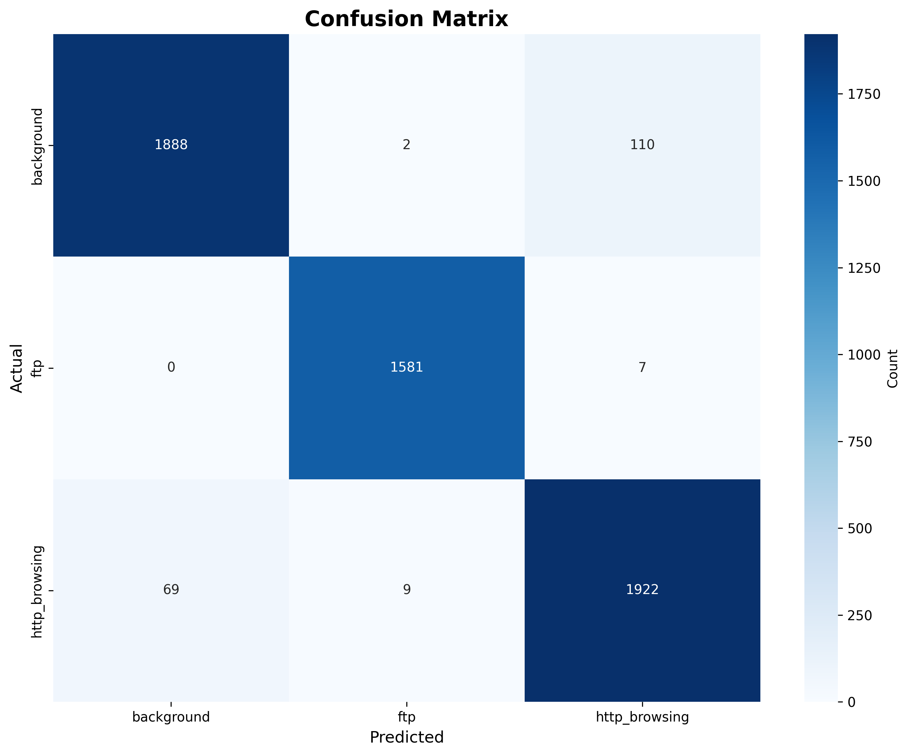

# XAI-QoS: Explainable Traffic Classification and Autonomous QoS Control for SDN

Code for the paper **"XAI-QoS: Attention-Based Explainable Traffic Classification and Autonomous QoS Control in Software-Defined Networks"**, Vignesh Karthikeyan, Joel Gibi, Aditya S and Dr. Monica K M (VIT Chennai). Accepted at CML 2026, forthcoming in Springer LNNS.

Deep-learning traffic classifiers are accurate but behave as black boxes, and post-hoc explainers like SHAP add 50–100 ms per flow, which is far too slow for an SDN controller. XAI-QoS builds the explanation **into** the model: a multi-head attention classifier produces feature-importance scores during the same forward pass that classifies the flow. Those explanations are then turned into OpenFlow QoS rules automatically, giving a closed loop from classification to enforcement with no operator in the middle.

## Results (CICIDS2017, 3 application classes)

| Metric | Value |
|---|---|
| Test accuracy | **96.74%** (validation 97.17%) |
| Weighted F1 | 0.97 |
| End-to-end latency | **0.73 ms per flow** (classification, explanation and policy) |
| Throughput | 8,200 flows/s (batch of 64) |
| Explanation overhead vs SHAP | 50–100× lower |
| vs feed-forward baseline | +2.51 percentage points accuracy |
| Policy correctness vs expert rules | 99% correct priorities, 96.5% correct QoS parameters |
| Model size | 67,651 trainable parameters |

Per-class F1: background 0.96, FTP 0.99, HTTP browsing 0.96. Training takes about 4.5 minutes on an Apple M1 (PyTorch, MPS backend).



## How it works

```
flow features (50)
      │
      ▼
Attention classifier ──► class + per-feature attention weights
      │                         │
      │                         ▼
      │                 XAI engine: top-5 features → semantic rules → plain-English explanation
      │                         │                     + confidence (prediction margin)
      ▼                         ▼
Policy translator: class → QoS profile → OpenFlow 1.3 FlowMod (queue, DSCP, priority, timeouts)
      │
      ▼
Ryu controller: polls flows every 5 s, LRU cache of 10,000 classified flows, installs rules on switches
```

1. **Attention classifier** (`xai_qos/traffic_classifier/attention_classifier.py`): a 2-layer feature extractor (50 → 128 → 64), 3 stacked multi-head attention layers (8 heads each), and a small classification head. The attention weights, averaged across heads, are the explanation, and extracting them costs under 0.1 ms.
2. **XAI engine** (`xai_qos/xai_engine/attention_explainer.py`): ranks the top-5 features, maps them to domain meaning (e.g. packet size > 1200 bytes → "media content"), and fills a template sentence. It's deterministic, so explanations are reproducible: the top feature was the same in 98% of repeated runs. Predictions with a margin below 0.3 are flagged for an operator to review.
3. **Policy translator** (`xai_qos/sdn_controller/policy_translator.py`): maps each class to a QoS profile (priority, queue, DSCP per RFC 2474, latency and bandwidth targets) and builds OpenFlow 1.3 FlowMod messages. Bandwidth is scaled down under congestion (link utilisation ≥ 80%) while keeping the relative priorities.
4. **Ryu controller** (`xai_qos/sdn_controller/ryu_controller.py`): runs the loop in the network.

## Dataset

[CICIDS2017](https://www.unb.ca/cic/datasets/ids-2017.html) flow CSVs, with the 15 original labels mapped to 3 QoS-relevant classes: **HTTP browsing** (benign and web traffic), **background** (DoS, port scan, bot, infiltration) and **FTP**. The data is balanced to 27,938 flows (10,000 / 10,000 / 7,938) using 50 selected features, and split 70/10/20 with stratification. The dataset itself isn't included in this repo, so download it from the link above.

## Running it

```bash
python -m venv .venv && source .venv/bin/activate
pip install -r requirements.txt

# train (expects a preprocessed CSV with 50 feature columns and a 'label' column)
python scripts/train_classifier.py --data data/processed/traffic_data.csv --epochs 50

# evaluate the saved model and print explanations for real test flows
python test_xai_explanation.py

# run the framework (pass the config path explicitly)
python xai_qos/main.py --config config/xai-qos-config.yaml
```

The trained model is in `models/xai_qos_classifier.pth`, with training checkpoints in `checkpoints/`. Training curves and metrics are in `training_history.png`, `training_results.json` and `test_results.json`. The SDN part needs Ryu 4.34 and Mininet on Linux.

## Repository layout

```
xai_qos/
  traffic_classifier/   attention-based classifier
  xai_engine/           attention → natural-language explanations
  sdn_controller/       policy translator and Ryu controller
  utils/                config loading
  main.py               framework entry point
scripts/train_classifier.py
test_xai_explanation.py
config/xai-qos-config.yaml
models/, checkpoints/   trained weights
```

## Limitations

- Evaluated on 3 application classes from one dataset (CICIDS2017). More classes, such as VoIP and streaming, and encrypted traffic are future work.
- Most errors are between background and HTTP browsing traffic, since some attack flows look like normal web traffic.
- The QoS policies are checked against expert-written rules, not yet measured on a live production network.

## Citation

```
V. Karthikeyan, J. Gibi, A. S, and M. K M, "XAI-QoS: Attention-Based Explainable Traffic
Classification and Autonomous QoS Control in Software-Defined Networks," in Proc. CML 2026,
Lecture Notes in Networks and Systems, Springer (forthcoming).
```
